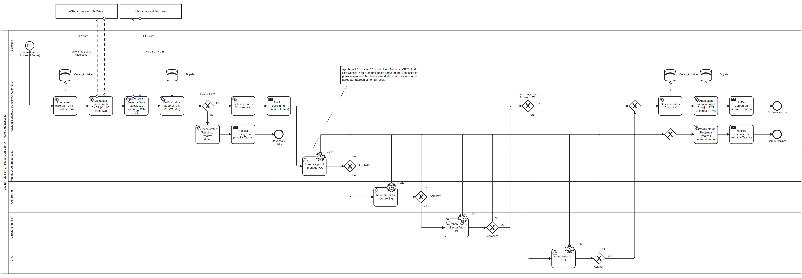
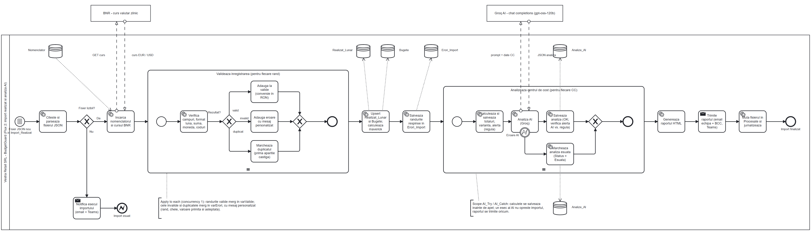
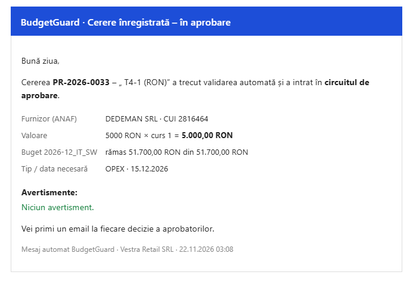
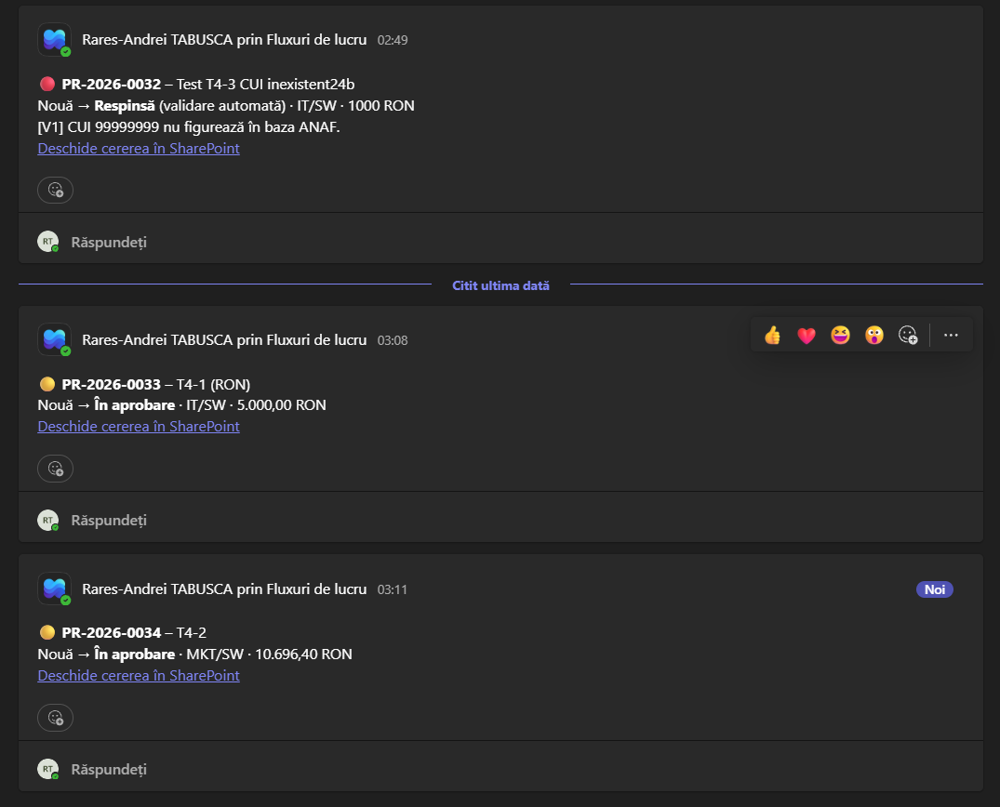
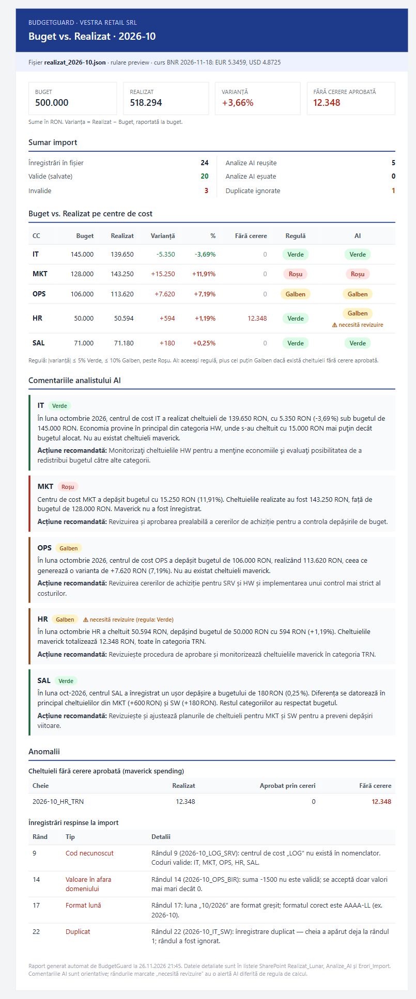

# BudgetGuard

**Budget-control automation on the Microsoft Power Platform**: purchase requests validated against live public registries and the budget, routed through sequential approvals, committed to the budget, and reconciled monthly against actual spend with an LLM writing the variance commentary.

Built for a fictional retail chain, *Vestra Retail SRL* (5 cost centres, 6 spend categories, 120 monthly budget lines).

> **Status:** all three flows are built and tested end-to-end: purchase requests and export (14 test cases), monthly actuals import with AI analysis (5 test cases, and **121/121 checks** against an independent Python reference implementation). The HTML report rendered by the flow matches a locally generated preview by construction.
>
> Step-by-step build guides and test documentation are in Romanian (`docs/`); code, schemas and this README are in English.

---

## The business problem

Budget overruns are usually discovered after the money is spent. BudgetGuard moves the control **before** the commitment and closes the loop **after** it:

1. **Before** – every purchase request is validated (supplier, FX rate, budget headroom) and approved by the right people *before* it can consume budget.
2. **During** – approved amounts are committed against the budget line, so the remaining budget is always current.
3. **After** – actual monthly spend is imported, compared with budget and with approved requests; spend that never had an approved request (**maverick spending**) is flagged, and an LLM drafts the variance commentary for each cost centre.

## Architecture

```
Microsoft Forms ──► Power Automate: BG_Flux1_Cerere ──► SharePoint lists
                      │  HTTP ► ANAF (Romanian VAT registry)      Cereri_Achizitie (requests)
                      │  HTTP ► BNR  (central bank FX rates)      Bugete (budget lines)
                      │  Approvals · Gmail · Teams                Istoric_Stari (audit log)
                      ▼
               BG_Export (manual) ──► CSV / JSON file in SharePoint + e-mail
                                                                  ▲
SharePoint library (JSON upload) ──► BG_Flux2_Import ─────────────┘  reads approved requests
                      │  HTTP ► BNR · HTTP ► Groq LLM (JSON mode)
                      └► Realizat_Lunar · Analize_AI · Erori_Import ► HTML report (e-mail + Teams)
```

| Layer | Technology |
|---|---|
| Process design | BPMN 2.0 (generated programmatically with diagram interchange, validated with bpmn-js) |
| Workflows | Power Automate cloud flows inside a solution (connection references, environment variable for the API key) |
| Data | SharePoint Online lists, provisioned from a declarative JSON schema via the SharePoint REST API |
| Integrations | ANAF VAT API v9, BNR XML rates feed, Groq chat completions (`openai/gpt-oss-120b`, JSON mode) |
| Notifications | Approvals (Teams), Gmail connector, Teams channel messages |
| Tooling | Python (data generation, reference implementation, API probes, prompt calibration), Node (BPMN rendering) |

## Process design (BPMN 2.0)

The diagrams were designed **before** implementation; each flow action carries a note with the ID of the BPMN element it implements.

**Flow 1 – Purchase request**


**Flow 2 – Monthly actuals import and AI analysis**


## Flow 1 – Purchase request (built, tested)

1. **Intake** – an 11-question Microsoft Form (text, number, choice, drop-down, date, rating, long text). Answers are mapped once into a normalised object, so the rest of the flow never touches Forms' generated question IDs.
2. **Registration** – the request gets a human-readable ID (`PR-2026-0039`) and status *New*; every state change is written to an audit log.
3. **Enrichment & validation** – all rules run to completion so the requester gets *every* problem in one e-mail:

   | Code | Rule | Effect |
   |---|---|---|
   | V1 / V2 / V2b | Supplier exists in the ANAF registry, is not fiscally inactive, not deregistered | reject |
   | V3 | 0 < value in RON ≤ configurable ceiling (BNR rate applied for EUR/USD) | reject |
   | V4 | Needed-by date ≥ today + configurable lead time | reject |
   | V5 | A budget line exists for month × cost centre × category | reject |
   | W1 | Value exceeds remaining budget → **CFO added to the approval chain** | warn |
   | W2 | Hardware above the capitalisation threshold booked as OPEX | warn |
   | W3 / W4 | Supplier not VAT-registered · BNR unavailable → fallback rate from config | warn |

4. **Sequential approvals** – a *Do until* loop over an approver list built at runtime from configuration: 3 approvers, 4 when over budget or above the CFO threshold, 1 in demo mode. Each step shows the full context and previous decisions; rejection stops the chain; a 7-day timeout counts as rejection.
5. **Budget commitment** – on approval the budget line is **re-read** (days may have passed) and `Committed` / `Remaining` are updated; a negative remainder stays visible by design.
6. **Notifications** – colour-coded HTML e-mails and Teams channel messages at every transition.

All thresholds and approver addresses live in a SharePoint `Config` list, so behaviour changes without editing the flow.

| Requester e-mail (validated, in approval) | Teams channel (state transitions) |
|---|---|
|  |  |

## Export flow (built, tested)

Manually triggered with a date range, optional cost-centre / category filters and a format (CSV or JSON). The OData filter is built dynamically; only *Approved* requests are exported and then marked *Exported*, so **re-running the same export never duplicates records**. The CSV carries a UTF-8 BOM so diacritics open correctly in Excel; the e-mail includes the file link, the row count and the total computed with an XPath sum over the JSON.

## Flow 2 – Actuals import & AI analysis (built, tested)

- JSON upload → permissive schema parse → row-level validation (required fields, month format, domain, unknown codes, duplicates – first occurrence wins) → invalid rows logged with explicit messages.
- **Upsert** on a composite key `{month}_{costCentre}_{category}`, so re-importing the same file updates instead of duplicating.
- Budget vs. actual per cost centre, rule-based alert (Green / Amber / Red), **maverick spend** = actual − approved requests.
- **LLM commentary** per cost centre, returned as schema-validated JSON. The figures are saved *before* the AI call; if the call fails (bad key, 429, timeout, malformed JSON) the analysis is marked failed with the reason and the report is still sent.
- When the AI alert differs from the rule-based alert, the cost centre is flagged **"needs review"** – in the test data this catches HR, which is on budget overall but spent 12,348 RON on training with no approved request.
- **Try / Catch** around the whole import: a corrupt or malformed file produces a plain-language failure e-mail and Teams message, and nothing is half-written.
- The processed file is archived with the run ID as suffix; every run is logged.

**Monthly report** (rendered from the test oracle; the flow builds the same HTML from the same fragments):



### Prompt calibration

The prompt was calibrated locally before touching the flow (`ai/test_prompt.py`):

- the variance is computed deterministically and sent to the model – the LLM explains, it does not do arithmetic;
- the model must pick the categories that explain the *direction* of the variance and quote the RON difference;
- the alert rule is stated explicitly, including "maverick spend lifts Green to Amber".

Result: **5 rounds × 5 cost centres → 25/25 schema-valid responses and 25/25 alerts matching the expected result**, including the deliberately tricky case where a cost centre is on budget overall but has maverick spending and must be flagged for review. The free-tier rate limit (8k tokens/min, ~2k per call) drove a fixed retry policy and pacing between calls.

## Testing approach

- **Reference implementation** – `scripts/reference_pipeline.py` reproduces Flow 2 in Python and writes `data/expected/expected_results.json`, used as the test oracle for the real flow.
- **Deterministic test data** – `scripts/generate_data.py` builds budgets, historical requests and an import file with planted errors (unknown code, negative amount, malformed month, duplicate) and a scripted demo scenario (one Red, one Amber, one hidden maverick case).
- **Test plan** – `docs/plan_testare.md`: 11 purchase-request cases (happy path RON/EUR, each validation, CFO step, rejection mid-chain, CAPEX warning, demo mode, timeout), 3 export cases and 5 import cases (full import, re-import without duplicates, invalid AI key, corrupt JSON, wrong structure), each with exact inputs, expected result and actual outcome.
- **Automated comparison** – `scripts/compare_results.py` reads the SharePoint list exports after a run, recomputes the oracle with the FX rate the flow actually used, and compares every row, error and cost-centre figure (121 checks, 0 differences).
- **Design ↔ build concordance** – `docs/concordanta_bpmn.md` maps every BPMN element to the flow actions that implement it; the 10 differences found are documented (6 fixed in the diagrams, 1 in the flow, 3 kept with a rationale).
- **API probes** – the ANAF, BNR and Groq response shapes were captured from real calls (`samples/`) before writing any parsing schema.

## Notable implementation details

- **Config as an object** – the `Config` list is turned into a single JSON object (`Select` + `join` + `json()`), so any setting is read as `outputs('cfg')?['prag_cfo_ron']`.
- **Failure paths are explicit** – *Run after* on failure/timeout handles a 404 from ANAF for unknown VAT IDs, the BNR fallback rate, approval timeouts, and Teams notifications that must go out even if e-mail fails.
- **Timeout-safe decision object** – approval results are read with `actions('Aprobare')?['outputs']?['body']`, which yields `null` instead of failing when the approval timed out.
- **One source for the report** – the HTML template and its row fragments are rendered by `report/render_preview.py` for the preview, and the same script generates the Power Automate `Select` / `replace()` expressions, so the e-mail and the preview cannot drift apart.
- **Infrastructure as data** – all 8 lists and 2 libraries (94 REST calls) and the seed data (169 calls) are provisioned by one flow from generated JSON, not by clicking.

## Repository layout

```
ai/            system prompt, response schema, calibration script and samples
bpmn/          BPMN generator, .bpmn files, rendered PNG/SVG
data/          seed CSVs, import file (JSON + XLSX), expected results, robustness test files
docs/          build guides, expression catalogue, test plan, screenshots (Romanian)
samples/       real API responses (ANAF, BNR, Groq)
powerbi/       data model and DAX measures for the Power BI report
report/        HTML report template, row fragments, preview renderer
schemas/       Parse JSON schemas
scripts/       API probes, data generator, reference pipeline, result comparison
sharepoint/    declarative list schema → REST provisioning requests
```

## Run the local tooling

```bash
pip install requests pandas openpyxl python-dotenv jsonschema
cp .env.example .env               # add GROQ_API_KEY and GROQ_MODEL
python scripts/generate_data.py    # deterministic test data
python scripts/reference_pipeline.py
python ai/test_prompt.py --rounds 5
python report/render_preview.py    # report/preview.html  (--flow: generate the flow expressions)
cd bpmn/tools && npm install && node render.mjs
```
